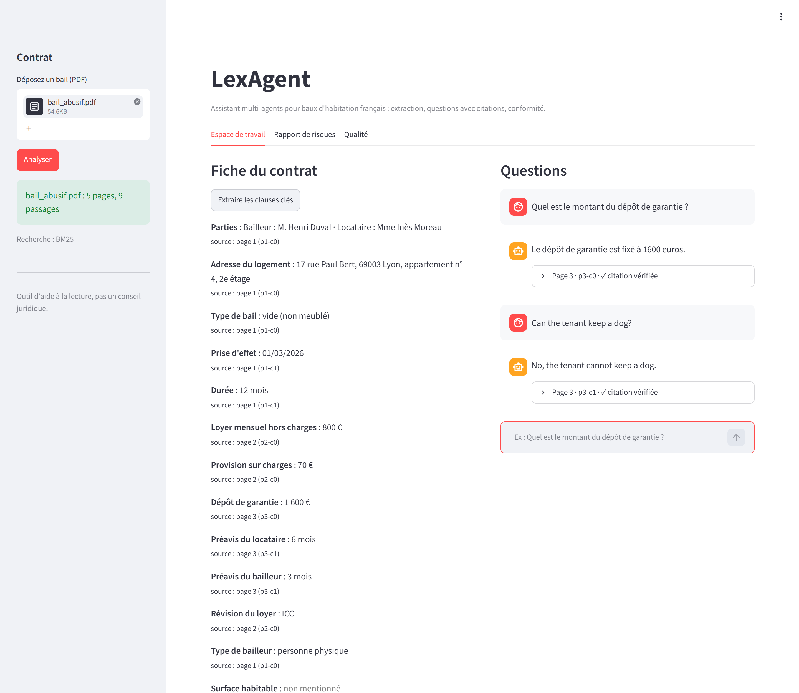
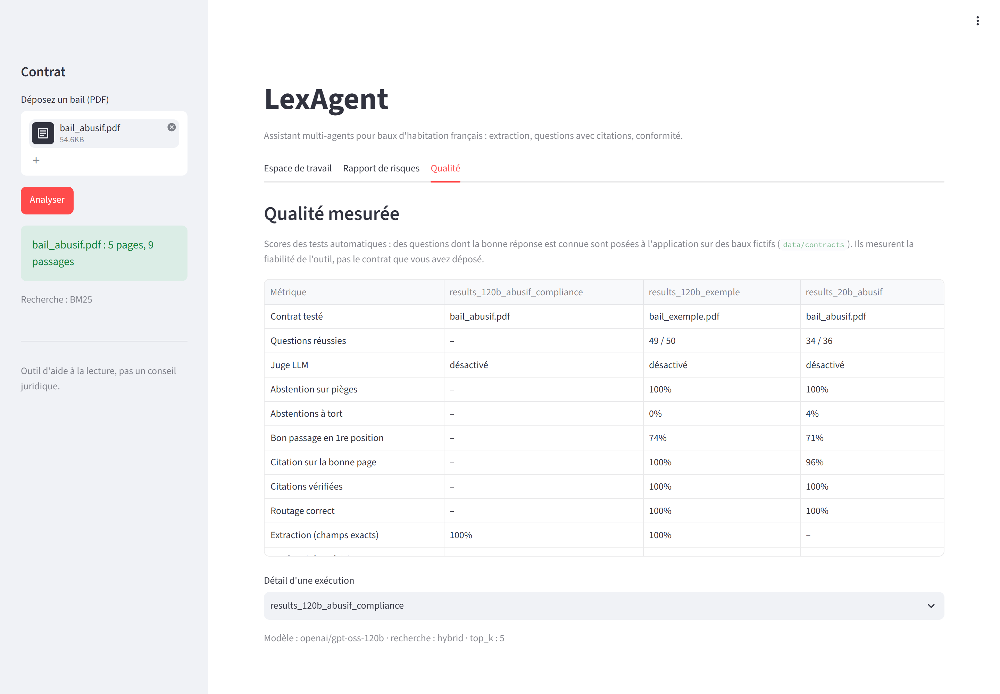

# LexAgent

AI assistant for French residential leases: it extracts the key terms, answers questions with
cited passages, and flags illegal or missing clauses with the law article.

> Demo project, not legal advice.

## Screenshots

Contract summary with the source page of each field, and questions answered with a verified quote
(fictional lease `data/contracts/bail_abusif.pdf`):



Every answer is measured on test leases:



## Features

- **Extract**: parties, rent, deposit, duration, notice periods... as validated JSON
- **Ask**: questions in French or English, each answer linked to a verified quote from the contract
- **Check**: compliance report against loi n° 89-462 (deposit cap, minimum duration, notice
  periods, rent indexation, mandatory mentions, abusive clauses)
- **Measure**: evaluation suite on fictional test leases, run in CI

## Stack

LangGraph · FastAPI · Streamlit · hybrid retrieval (BM25 + multilingual embeddings) ·
any OpenAI-compatible LLM (Groq, Ollama, Mistral...) · MCP server · optional Langfuse tracing

## Run locally

```bash
cp .env.example .env              # add your LLM_API_KEY
pip install -r requirements.txt
streamlit run ui/streamlit_app.py # http://localhost:8501
```

The UI runs the API in-process. To run the API on its own: `uvicorn app.main:app`
(docs at http://localhost:8000/docs). Tests: `pytest -q`

## Deploy (Streamlit Community Cloud)

On [share.streamlit.io](https://share.streamlit.io), create an app from this repo with main file
`ui/streamlit_app.py`, and add these secrets:

```toml
LLM_API_KEY = "your-groq-key"
LLM_BASE_URL = "https://api.groq.com/openai/v1"
LLM_MODEL = "openai/gpt-oss-120b"
DEMO_PASSWORD = "choose-a-password"   # optional, protects your LLM quota
EMBEDDING_MODEL = ""                  # keyword search only: lighter on the free tier
```

## Results

On two fictional leases (`data/contracts/`): 100% of fields extracted correctly, all 14 planted
legal problems flagged with no false alarms, and 83 of 86 test questions passed (answer found
and cited from the right page). Details: `evals/`.
